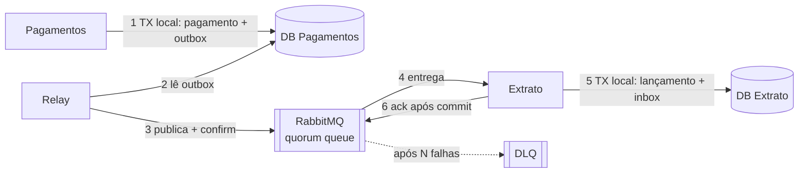

# SPEC Caso A: Entrega atômica (outbox/inbox) — Pagamentos → Extrato

> **Status:** rascunho para PoC · **Padrão validado:** outbox/inbox (commit no banco local + envio/consumo de mensagem)
> **Relacionado:** `spec-caso-b-saga-orquestrada.md` (reaproveita o módulo `mensageria-core` definido aqui)

---

## 1. Contexto e objetivo

Substituir a coordenação XA (transaction manager + SQL Server + ActiveMQ) por **transações locais no SQL Server + RabbitMQ**, sem que um processamento fique pela metade.

Este caso valida o padrão mais simples: uma aplicação muda estado e publica uma mensagem; outra aplicação consome a mensagem e aplica o efeito no seu próprio banco.

**Pergunta que a PoC responde:** produtor e consumidor, cada um com seu banco, conseguem manter consistência eventual correta (sem perda e sem efeito duplicado) sob falhas, sem transação distribuída?

## 2. Escopo

**Dentro:**
- Aplicação **Pagamentos**: registra pagamento e publica `PagamentoRecebido`.
- Aplicação **Extrato**: consome `PagamentoRecebido` e grava o lançamento previsto.
- Módulo compartilhado **`mensageria-core`**: outbox, relay, inbox, envelope, retry/DLQ, métricas.
- Job independente de **reconciliação**.

**Fora:**
- Coordenação de vários passos com compensação (ver Caso B).
- CDC/Debezium, ponte ActiveMQ ↔ RabbitMQ, decisões de replicação/sincronização de bancos (fora do escopo do departamento).

## 3. Restrições técnicas

- Banco: SQL Server, **um schema/banco separado por aplicação** (não pode existir transação local entre Pagamentos e Extrato).
- Broker: RabbitMQ, filas **quorum**, com **publisher confirms** e **ack manual** no consumidor.
- Java e driver JDBC: **usar a versão mais antiga que precisa ser suportada** (⚠️ definir qual). O núcleo `mensageria-core` não pode depender de Spring Boot; adaptadores finos por versão de framework.
- Sem XA, sem JTA, sem transaction manager externo.
- Nenhum número de desempenho é meta; as métricas são observação.

## 4. Arquitetura



## 5. Modelo de dados

### 5.1 Pagamentos

```sql
CREATE TABLE pagamento (
  pagamento_id   UNIQUEIDENTIFIER PRIMARY KEY,
  cooperado_id   BIGINT           NOT NULL,
  valor          DECIMAL(18,2)    NOT NULL,
  status         VARCHAR(20)      NOT NULL,   -- RECEBIDO
  criado_em      DATETIME2        NOT NULL DEFAULT SYSUTCDATETIME()
);

CREATE TABLE outbox (
  seq            BIGINT IDENTITY(1,1) PRIMARY KEY,
  message_id     UNIQUEIDENTIFIER NOT NULL,
  aggregate_key  NVARCHAR(100)    NOT NULL,   -- pagamento_id (chave de ordenação)
  type           NVARCHAR(100)    NOT NULL,
  schema_ver     SMALLINT         NOT NULL,
  payload        VARBINARY(MAX)   NOT NULL,   -- payload mínimo
  created_at     DATETIME2        NOT NULL DEFAULT SYSUTCDATETIME()
);
```

### 5.2 Extrato

```sql
CREATE TABLE extrato_lancamento (
  lancamento_id  UNIQUEIDENTIFIER PRIMARY KEY,
  pagamento_id   UNIQUEIDENTIFIER NOT NULL UNIQUE,
  cooperado_id   BIGINT           NOT NULL,
  valor          DECIMAL(18,2)    NOT NULL,
  situacao       VARCHAR(20)      NOT NULL,   -- PREVISTO
  criado_em      DATETIME2        NOT NULL DEFAULT SYSUTCDATETIME()
);

CREATE TABLE inbox (
  message_id     UNIQUEIDENTIFIER PRIMARY KEY,  -- unique = dedup
  consumed_at    DATETIME2        NOT NULL DEFAULT SYSUTCDATETIME()
);
```

> Os esquemas são esboços para a PoC. Ajustar nomes, tipos e índices com o DBA. O `UNIQUE (pagamento_id)` em `extrato_lancamento` é uma segunda barreira contra duplicidade, além da inbox.

## 6. Contrato de mensagem

### 6.1 Envelope padrão (todas as mensagens)

| Campo | Tipo | Descrição |
|---|---|---|
| `messageId` | UUID | Identificador único da mensagem (chave de dedup) |
| `correlationId` | UUID | Liga mensagens do mesmo processo (usado também pelo Caso B) |
| `idempotencyKey` | string | Chave de idempotência do efeito de negócio |
| `aggregateKey` | string | Chave de ordenação |
| `type` | string | Tipo do evento (ex.: `PagamentoRecebido`) |
| `schemaVersion` | int | Versão do contrato do payload |
| `occurredAt` | ISO-8601 UTC | Momento do fato de negócio |
| `payload` | objeto | Dados do evento |

### 6.2 `PagamentoRecebido` (v1)

```json
{
  "pagamentoId": "uuid",
  "cooperadoId": 123,
  "valor": "150.00"
}
```

## 7. Requisitos funcionais

| ID | Requisito |
|---|---|
| RF-A1 | Ao receber uma solicitação de pagamento, Pagamentos DEVE gravar `pagamento` e a linha da `outbox` **na mesma transação local**. Se a transação falhar, nenhuma das duas existe. |
| RF-A2 | O relay DEVE publicar cada linha da outbox no RabbitMQ usando publisher confirms, e só considerar a linha enviada após o confirm. |
| RF-A3 | O relay DEVE garantir publicação **at-least-once** e preservar a **ordem por `aggregateKey`**. Não é exigida ordem global. |
| RF-A4 | Deve existir **no máximo um relay ativo** por banco de origem, controlado por lease. Se dois relays rodarem por falha, não pode haver perda de mensagem. |
| RF-A5 | O relay DEVE rodar somente quando o banco for o primário/ativo (configurável), para nunca publicar a partir de uma cópia. |
| RF-A6 | Extrato DEVE, para cada mensagem recebida, gravar o `extrato_lancamento` **e** o registro na `inbox` na mesma transação local e só então confirmar a mensagem (ack). |
| RF-A7 | Se o `messageId` já estiver na `inbox`, Extrato DEVE descartar a mensagem (com ack) sem reaplicar o efeito. |
| RF-A8 | Falhas no processamento DEVEM seguir política de retry com **backoff**, e após um limite configurável de tentativas a mensagem DEVE ir para a DLQ, sem bloquear a fila. |
| RF-A9 | A outbox DEVE ter política de **retenção/limpeza** configurável, que não afete a ordem nem a segurança do relay. |
| RF-A10 | `mensageria-core` DEVE expor métricas: lag da outbox, mensagens pendentes, duplicatas descartadas, mensagens em DLQ, tentativas de retry. |
| RF-A11 | O `correlationId` e o `traceId` DEVEM ser propagados nos headers e nos logs de ponta a ponta. |

## 8. Decisão em aberto no desenho do relay (a PoC deve resolver)

No SQL Server, o valor de `IDENTITY` é atribuído **antes do commit**. Uma transação com `seq = 10` pode confirmar depois de outra com `seq = 11`. Um relay que lê "tudo maior que o último `seq`" pode pular a linha 10.

Implementar o relay atrás de uma interface e **construir as duas estratégias** para comparação:

| | Estratégia 1: claim | Estratégia 2: ponto de leitura |
|---|---|---|
| Mecanismo | `SELECT ... WITH (UPDLOCK, READPAST, ROWLOCK)`, publica e marca/remove a linha | Lê até um limite seguro e persiste o ponto de leitura (ex.: coluna `rowversion` com `min_active_rowversion()` ⚠️ confirmar semântica na versão usada) |
| Escrita no banco | UPDATE/DELETE por linha | Insert-only; limpeza em lote |
| Ordem por agregado | Exige cuidado ao reservar lotes | Natural, se respeitado o limite seguro |

A escolha final vira ADR com as observações da PoC.

## 9. Requisitos não funcionais

- **Observabilidade:** logs estruturados com `messageId`, `correlationId`, `aggregateKey`; métricas expostas em formato consumível pela operação (Micrometer ⚠️ confirmar compatibilidade com a versão de Java).
- **Memória:** relay e consumidor não podem crescer sem limite (RSS estável sob carga). Definir limites explícitos de heap e de memória direta.
- **Operabilidade:** o relay precisa ser reiniciável a qualquer momento sem intervenção manual.
- **Portabilidade:** o núcleo não conhece o RabbitMQ além de uma interface de publicação/consumo; troca de broker deve exigir só um novo adaptador.

## 9.1 Fora de escopo de desempenho

Nenhuma meta de latência ou throughput. As métricas coletadas servem para análise posterior.

## 10. Invariantes (verificados pelo job de reconciliação)

| ID | Invariante |
|---|---|
| A1 | Todo `pagamento` com status `RECEBIDO` tem **exatamente um** `extrato_lancamento`, eventualmente |
| A2 | Não existe `extrato_lancamento` sem `pagamento` correspondente |
| A3 | Mensagens do mesmo `aggregateKey` são aplicadas **em ordem** |
| A4 | Nenhuma linha fica indefinidamente na `outbox` sem ser publicada, enquanto o broker estiver disponível |

O reconciliador **deve ser escrito a partir destas invariantes, de preferência por outra pessoa** que não implementou o fluxo.

## 11. Cenários de aceite

```gherkin
Cenário: Fluxo feliz
  Dado um pagamento válido solicitado
  Quando Pagamentos grava o pagamento
  Então a linha da outbox existe na mesma transação
  E Extrato grava exatamente um lançamento previsto
  E o relay e o consumidor registram métricas

Cenário: Falha na gravação do pagamento
  Dado que a transação local de Pagamentos falha antes do commit
  Então não existe pagamento nem linha na outbox

Cenário: A-F1 Relay cai depois de publicar e antes de registrar o envio
  Quando o relay é reiniciado
  Então a mensagem é publicada novamente
  E Extrato descarta a repetição pelo dedup
  E A1 e A2 continuam verdadeiros

Cenário: A-F2 Consumidor cai entre o commit e o ack
  Quando o broker reentrega a mensagem
  Então a inbox detecta o messageId e descarta
  E existe um único lançamento

Cenário: A-F3 Broker indisponível e depois restaurado
  Dado que o RabbitMQ fica indisponível por um período
  Então as mensagens acumulam na outbox
  E após a volta todas são publicadas sem perda

Cenário: A-F4 Rede instável entre relay e broker
  Então o relay aplica retry com backoff, sem tempestade de tentativas

Cenário: A-F5 Dois relays ativos ao mesmo tempo
  Então não há perda de mensagem
  E duplicidades são absorvidas pela inbox

Cenário: A-F6 Mensagem inválida (veneno)
  Então após o limite de tentativas vai para a DLQ
  E as demais mensagens seguem sendo processadas

Cenário: A-F7 Transações concorrentes confirmam fora da ordem de seq
  Então nenhuma mensagem é pulada pelo relay (em ambas as estratégias)

Cenário: Ordem por agregado
  Dado dois eventos do mesmo aggregateKey
  Então são aplicados na ordem em que ocorreram
```

## 12. Tarefas sugeridas

1. Ambiente de teste: SQL Server (um schema por aplicação), RabbitMQ (quorum), Testcontainers e Toxiproxy ⚠️ confirmar compatibilidade com a versão de Java.
2. `mensageria-core`: envelope, outbox (insert), interface do relay, lease de relay único, publisher com confirms, consumidor com ack manual, inbox, retry/backoff/DLQ, métricas.
3. Estratégia de relay 1 e estratégia de relay 2 atrás da mesma interface.
4. Aplicação Pagamentos (endpoint de solicitação + gravação transacional).
5. Aplicação Extrato (consumidor + gravação transacional).
6. Job de reconciliação (a partir das invariantes).
7. Suite de testes de falha A-F1 a A-F7, executável de forma repetível.
8. Relatório com observações (lag, duplicatas, tempo de recuperação, linhas de código, testes necessários).

## 13. Critérios de conclusão

- Invariantes A1 a A4 verdadeiras ao final de todas as falhas injetadas, verificadas pelo reconciliador.
- Nenhuma intervenção manual para chegar a um estado consistente.
- Funciona na versão de Java e driver mais antigas definidas na seção 3.
- Decisão registrada entre as estratégias de relay.

## 14. Perguntas em aberto

- Qual a versão mínima de Java, de Spring (se houver) e do driver JDBC a suportar?
- Quem escreve o reconciliador?
- O código da PoC é descartável ou evolui para o starter interno?
